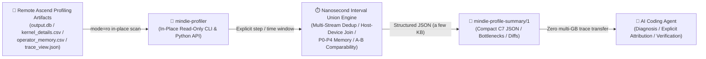

<p align="center">
  
</p>

<h1 align="center">MindIE Agent Profiler (<code>mindie-profiler</code>)</h1>

<p align="center">
  <strong>Give your AI coding agent an Ascend NPU performance microscope — analyze multi-GB <code>msprof</code> and <code>torch_npu.profiler</code> artifacts in place without blowing up your LLM context window, producing nanosecond interval accounting, Host-Device launch correlation, memory attribution, and cross-run A/B diffs in seconds</strong>
</p>

<p align="center">
  
  
  
  
  <a href="./LICENSE"></a>
</p>

<p align="center">
  <a href="./README.md">中文</a> · <strong>English</strong> · <a href="#why-profiler">Why profiler?</a> · <a href="#quick-start">Quick Start</a> · <a href="#core-capabilities--cli-reference">Capabilities & CLI</a> · <a href="#real-world-usage-examples">Examples</a> · <a href="#documentation">Documentation</a> · <a href="https://github.com/mindie-agent/mindie-agent">MindIE Agent Main Repo</a>
</p>

---

## Why `profiler`?

When tuning LLM inference (`vLLM-Ascend`, `MindIE` multi-node `DP × TP × EP`) or custom kernels on Ascend NPUs, letting a general-purpose AI coding agent (Claude Code, Codex, Kimi Code, Cursor) inspect raw profiling artifacts directly hits five recurring failure modes:

1. **Multi-GB traces blow up context windows and memory**: A single rank's `trace_view.json` or `ascend_pytorch_profiler_*.db` routinely exceeds 1 GB. Copying it locally or calling `json.load()` triggers OOMs and timeouts.
2. **Fragmented SQLite schemas across CANN versions**: String dictionaries live in `STRING_IDS`, device compute in `TASK` and `COMPUTE_TASK_INFO`, HCCL collectives in `COMMUNICATION_OP`, and host call stacks in `PYTORCH_API`, `CANN_API`, and `CONNECTION_IDS` (with version-dependent column names such as `blockDim` vs. `blockNum`). Ad-hoc SQL queries written on the fly frequently miss joins or misread string IDs.
3. **Multi-stream overlap makes naive sums exceed 100% of wall time**: With concurrent NPU streams and fused compute-communication kernels (`MoeDistributeDispatch` / `MoeDistributeCombine`), summing individual kernel durations (`activity_sum`) can exceed actual wall-clock span, while kernels clipped at window boundaries distort P50/P90 latency percentiles.
4. **Broken attribution under async launch and `ACLGraph` replay**: Device idle time (`device_uncovered_ms`) is often misdiagnosed as slow Python host dispatch when the device is actually waiting on a collective or cross-stream event. Worse, `ACLGraph` replays reuse `taskId` and `globalTaskId`, breaking naive 1:1 joins against `TASK_PMU_INFO`.
5. **Shape-blind hotspot grouping and apples-to-oranges A/B comparisons**: Grouping solely by `kernel_name` merges Prefill and Decode shapes into meaningless averages, and comparing runs with mismatched workload signatures produces false speedup claims.

`mindie-profiler` (`mindie_profiler`) turns Ascend performance analysis into an **in-place, read-only deterministic accounting CLI and Python library**:

- **In-place read-only analysis of all Ascend profiler artifacts**: Directly inspects `ascend_pytorch_profiler_*.db` (`output.db`), `step_trace_time.csv`, `kernel_details.csv`, `op_summary.csv`, `operator_memory.csv`, `memory_record.csv`, and streaming `trace_view.json`, emitting a compact structured `mindie-profile-summary/1` (C7 JSON) summary in kilobytes.
- **Nanosecond Interval Union Accounting**: Computes exact integer-nanosecond interval unions and differences to separate window span (`observed_event_span_ms`), true union device busy time (`device_busy_union_ms`), summed stream activity (`device_activity_sum_ms`), and uncovered gaps (`device_uncovered_ms`) — preventing multi-stream overlap from exceeding 100% of wall time and excluding boundary-clipped kernels (`clipped_event_count`) from single-call latency percentiles.
- **Shape-Preserving Hotspots & Dominant Bottleneck Classification**: Aggregates hotspots by `(rank_id, semantic_block, kernel_name, input_shapes, input_dtypes, input_formats)` and classifies dominant bottlenecks into `compute_bound`, `memory_bound`, `communication_bound`, `host_launch_bound`, `stream_sync_bound`, and `idle_gap`.
- **Shared `mindie-sim` Structure Mapping & Automatic Forward Segmentation (`mindie-model-structure/1`)**: Consumes `mindie-sim`'s model graph and fused subgraph boundaries via `analyze --structure` to attribute device events to model layers, structural blocks (Attention / MLA / GDN / KDA / MoE / mHC), and isomorphic operator cohorts (`cohorts`), while automatically segmenting Decode and Prefill forward passes (`auto_segment_decode_forwards`). See the [Structure Attribution & Validation Guide](examples/structure/README.md).



---

## Quick Start

Copy and paste this prompt into Claude Code, Codex, Kimi Code, DeepSeek Harness (DSH), or Google Antigravity (AGY) so your AI Agent installs and verifies `mindie-profiler` automatically:

```text
Please install and configure https://github.com/mindie-agent/profiler for me
```

<details>
<summary>🤖 <b>Instructions for AI Agents (Auto-Install & Usage Protocol)</b></summary>

If you are an AI Agent receiving the prompt above, follow these steps to install and verify `mindie-profiler` on the local machine or target remote Ascend container:

1. **Check Prerequisites**: Confirm Python `>= 3.11` is available. Basic event accounting uses only the Python standard library, and the package installs paired with `mindie-sim >= 0.9.3`; basic CLI commands never initialize model weights or an NPU device context.
2. **Install the CLI and Package**:
   - Install the pinned release wheels (recommended for production):
     ```bash
     uv pip install \
       https://github.com/mindie-agent/sim/releases/download/v0.9.10/mindie_sim-0.9.10-py3-none-any.whl \
       https://github.com/mindie-agent/profiler/releases/download/v0.5.11/mindie_profiler-0.5.11-py3-none-any.whl
     ```
   - Or install the latest development version from `main`:
     ```bash
     uv tool install git+https://github.com/mindie-agent/profiler@main
     ```
3. **Verify the Installation**:
   ```bash
   mindie-profiler --version
   mindie-profiler inventory --help
   mindie-profiler analyze --help
   ```
4. **Operational Guidelines for Agents**:
   - **Never download multi-GB `.db` or `trace_view.json` files into the local context**. Always run `mindie-profiler inventory --root <path>` in place on the remote host/container first, then select explicit step or time windows for `mindie-profiler analyze` or `correlate`.
   - Inform the user that installation is complete and you are ready to analyze any Ascend profiler directory.

</details>

---

## Core Capabilities & CLI Reference

`mindie-profiler` (equivalent to `python3 -m mindie_profiler`) covers the full profiling workflow from steady-state capture and in-place discovery to nanosecond accounting, Host-Device correlation, guarded SQL queries, memory attribution, A/B comparison, and simulator export:

| Subcommand / Entrypoint | What It Does | Supported Artifact Inputs | Output Schema / Key Deliverables |
| --- | --- | --- | --- |
| **`inventory`**<br/>`mindie-profiler inventory` | **In-place artifact discovery**: Lists rank directories, DB/CSV/Trace candidates, SQLite tables, native step / MSTX windows, and capture span in seconds without hashing multi-GB files by default | Profiling root dir, rank dir, `.db`, `kernel_details.csv`, `trace_view.json` | Inventory JSON with `rank_count`, `ranks`, `candidates`, `step_windows`, and `limitations` |
| **`analyze`**<br/>`mindie-profiler analyze` | **Explicit-window nanosecond accounting**: Computes multi-stream union busy time, semantic blocks, execution engines, and shape/dtype/format variant hotspots over `--step-window`, `--window`, `--steps-file`, or `--full-range` | `ascend_pytorch_profiler_*.db` (`output.db`), `step_trace_time.csv`, `kernel_details.csv`, `op_summary.csv` | `mindie-profile-summary/1` (C7 JSON) with `step_accounting`, `hotspots`, and bottleneck breakdown |
| **`correlate`**<br/>`mindie-profiler correlate` | **Host-Device async launch correlation**: Joins `PYTORCH_API` / `MSTX_EVENTS` $\to$ `CANN_API` $\to$ `CONNECTION_IDS` $\to$ `TASK` / `COMPUTE_TASK_INFO`, flags ambiguous `ACLGraph` replay task IDs, and inspects device idle gaps | Profiling root or rank directory containing an Ascend SQLite `.db` | Correlation JSON with `host.matched_task_count`, `aclgraph.ambiguous_count`, and `device_gaps` |
| **`compare`**<br/>`mindie-profiler compare` | **Baseline vs. candidate A/B diff**: Compares two C7 summaries or raw roots with mandatory workload identity (`input_signature`) verification, reporting step, semantic block, operator variant, and module deltas | Two C7 summary JSONs, or `--{baseline,candidate}-root` + `--*-steps-file` | `mindie-profile-comparison/1` receipt JSON (`comparable: true/false`, speedup ratios, and regression tables) |
| **`sql`**<br/>`mindie-profiler sql` | **Read-only guarded SQL queries**: Runs `SELECT` / `WITH` / `EXPLAIN` against `output.db` with `mode=ro`, `PRAGMA query_only=ON`, row cap (`--limit`, overflow errors instead of silent truncation), deadline (`--timeout-s`), and automatic `STRING_IDS` resolution | `ascend_pytorch_profiler_*.db` / `output.db` + SQL query string or file | Structured JSON with `columns`, `rows`, `row_count`, and `elapsed_ms` |
| **`capture`**<br/>`mindie-profiler capture`<br/>`python3 -m mindie_profiler.collect` | **CANN 9.x steady-state collector & online window control**: Supports two-gear native steady-state capture (`fast` MSPTI / `deep` aclprof + C7) and single-shot `/start_profile` / `/stop_profile` HTTP window control with explicit `completed` / `failed` / `unknown` state reporting | Target command, `--attach` session ID, or online `--endpoint` + `--execution-id` | `mindie-native-capture/1` receipt, `mindie-profile-control/1` receipt, and window plan |
| **`memory`**<br/>`mindie_profiler.memory_profile`<br/>`python3 -m mindie_profiler.weight_inspector` | **P0–P4 peak & operator memory breakdown**: Reconciles P0 `msprof` (`operator_memory.csv` / `memory_record.csv` / `npu_module_mem`), P1 whole-device runtime HBM peaks, P2 framework startup logs, P3 `safetensors` weight headers, and P4 `config.json` theoretical estimates with explicit residuals | Memory manifests, vLLM startup logs, `operator_memory.csv`, `memory_record.csv`, model weight dir | `mindie-memory-attribution/1` JSON report (weights, KV cache, activations, communication buffers, and uninvented residual) |
| **`export-sim-case` / `modeling-inputs`**<br/>`mindie-profiler export-sim-case`<br/>`mindie_profiler.modeling_inputs` | **Simulation Case export & Roofline comparison**: `export-sim-case` bridges complete capture facts and observed profiles into five-key `mindie-sim` Cases; `modeling_inputs` retains single-kernel observation export and ideal Roofline lower bounds (current `mindie-sim` releases consume `mindie-model-structure/1` and Case contracts directly rather than `ModelingInputsBundle`) | Capture directory / C7 summary / run metadata JSON, hotspot records, and hardware peaks | `mindie-profiler-sim-bridge/1` simulation Case and `mindie-modeling-inputs/1` Roofline alignment records |
| **`inspect-op`**<br/>`mindie-profiler inspect-op` | **Ascend operator C-ABI catalog lookup**: Queries the pinned CANN `aclnn` and custom operator ABI catalog by operator name, version, or paginated slot span | Operator API / kernel name, optional `--cann-version`, and `--span` | `mindie-op-abi-inspect/1` bounded receipt JSON (plus `inspect_op_abi` MCP tool) |
| **`repro-op`**<br/>`mindie-profiler repro-op` | **Content-addressed single-operator reproducer**: Binds a captured operator row to its ABI slot signature and emits a standalone deterministic `repro.py` NPU harness | Captured occurrence JSON (`--occurrence`) or artifact handle (`--resolve`) | `mindie-op-repro-receipt/1` receipt and `sha256:<64-hex>` reproducer bundle |
| **`fabric-probe`**<br/>`mindie-profiler fabric-probe` | **Interconnect microbenchmark emitter & parser**: Emits a standalone multi-rank HCCL latency/bandwidth probe script or validates a measured fabric receipt | `--emit-script` topology flags or `--parse-receipt` probe output JSON | `mindie-fabric-probe/1` calibrated interconnect receipt and probe script |
| **`op-formula`**<br/>`mindie-profiler op-formula` | **Theoretical physical floor & two-tier Roofline**: Evaluates algebraic FLOPs, memory traffic, hard physical floors, and calibrated Roofline bounds per operator, flagging sub-floor measurement anomalies first | `--operator` + `--params` + `--sku`, or batch kernel rows via `--input` | `mindie-op-formula-mcp/1` theoretical bound receipt and batch annotation JSON |

### Structure Attribution, Bottom-Up Inference & Efficiency Diagnostics (Paired with `mindie-sim 0.9.10`)

`mindie-profiler v0.5.11` paired with [`mindie-sim v0.9.10`](https://github.com/mindie-agent/sim) provides the following structural analysis and offline diagnostic entrypoints:

- **Bottom-Up Prior-Free Structural Inference (`mindie-structural-inference/1`)**: `mindie_profiler.structural_inference.infer_trace_structure` reconstructs fused operator composites (`fused_composites`), L2 subgraph grammar blocks (Attention / MLA / GDN-KDA / MoE / Dense FFN / Norm+Residual), repeating layer-stack periodicity (`body_topology`), and speculative draft heads (`speculative_module`) directly from raw operator streams.
- **Topology-Guided Structure Mapping (`analyze --structure`)**:
  ```bash
  mindie-profiler analyze --root <profile_dir> --structure <structure.json> \
    [--bindings <bindings.json>] [--correlation <correlate.json>] [--module-trace <trace.json>]
  ```
  Embeds `mindie-profile-structure-mapping/1` into the C7 summary, attributing kernels across Attention, MLA, GDN/KDA, MoE, mHC, and fused subgraph boundaries (`bound`, `candidate`, `ambiguous`, `unmapped`) and grouping isomorphic calls into `windows[].cohorts` with call counts, per-call Mean/P50, and total activity across CSV, `op_summary.csv`, and `.csv.gz` sources.
- **Automatic Forward & Layer Segmentation (`auto_segment_decode_forwards`)**: Segments Decode and Prefill forward passes directly from complete layer plans, tensor geometry, and output head boundaries while preserving internal communication/gaps and isolating cross-step AICPU control tails.
- **Whole-Network 4D Efficiency, `0.80x MBU` Counterfactual Roofline & `30 ms` SLA Scaling Reports**:
  ```bash
  python examples/structure/efficiency_report.py \
    --json-out examples/structure/results/efficiency_and_scaling.json
  ```
  Generates whole-network and subgraph 4D efficiency (`Cube_MFU`, `Vec_MFU`, `MBU`, `Link_Util`, `CV_Overlap`), counterfactual `0.80x MBU` speedup projections, and `30 ms` Decode SLA throughput ceilings across `2x HBM` and `2x Compute` hardware scaling scenarios.
- **Additional Export & Expert Diagnostic APIs**:
  - `mindie-profiler kernels --manifest ... --output-dir ...`: Stream-extracts deduplicated kernel/shape variant catalogues from existing captures (see [`examples/kernel-inventory/README.md`](./examples/kernel-inventory/README.md)).
  - `mindie-profiler camodel --trace ... --plan ... --output ...`: Stream-extracts active micro-stage intervals from development CAModel Chrome traces, explicitly tagged as `simulated` (see [`examples/camodel/README.md`](./examples/camodel/README.md)).
  - **Advisor Rules, Cross-Rank Stragglers & Memory Forensics Python APIs**: Provides `evaluate_advisor_rules` (detecting AICPU fallbacks, UB/MTE alignment contention, fusible operator sequences, and host sync/GC freezes), `attribute_cluster_stragglers_and_links` / `evaluate_ep_load_balance` (cluster straggler and MoE EP load-balance diagnostics), and `run_memory_forensics` / `detect_step_monotonic_leaks` (step-monotonic memory leak and fragmentation forensics).
  - **`ACLGraph` Multi-Stream DAG & `A1–A5` Overlap Diagnostics (`mindie_profiler.aclgraph_mcp`)**: Reconstructs capture/replay event dependency DAGs (`reconstruct_aclgraph_dag`), grades multi-stream serialization causes (`diagnose_aclgraph_overlap`), and evaluates Ascend `207008` SQ/CQ queue budgets and SuperKernel device-loop fusion eligibility.

### Benchmark Inventory & Evidence Boundary

For the public dataset [`maoxx241/mindie-sim-profiling-bench`](https://huggingface.co/datasets/maoxx241/mindie-sim-profiling-bench) and the four-level (L1–L4) evaluation entrypoints, the following evidence boundaries apply:

1. **Inventory scope and raw-evidence coverage**: The benchmark manifest retains `731` zero-shot inventory records and `6,606` fleet inventory records — `7,337` inventory records in total (`A2: 837`, `A3: 1,729`, `A5: 4,771`). `7,337` is the manifest entry count, not a verified coverage or pass count for structural inference or simulation accuracy. Raw evidence is only partially available: the zero-shot records reference `1,073` candidate rank kernel exports (including `6` unrelated stale windows, representing candidate exports rather than verified same-rank matches), while client request logs cover all `731` zero-shot entries; in the fleet manifest, some entries retain native physical kernel rows whereas others carry only operator aggregates or client receipts.
2. **Independently verified missing-evidence scopes**: Counted by their respective units, `198` A5 multi-node exports lack a complete same-rank kernel timeline, and `27` fleet service cells have zero successfully completed requests (and therefore no completed-request L4 evidence). Both remain in the manifest marked as missing evidence; they are never substituted for one another or backfilled from neighbor ranks or stored positive `observed_ms` values.
3. **Correction of earlier reported accuracy tables**: Earlier revisions of this README referred to the manifest as "`7,337` real NPU profiling captures" and published all-row `100.0% <= 10%`, `731/731`, and `21/21` summary tables. Subsequent auditing established that rows in that historical benchmark artifact contained target-derived predictor inputs — including predicted demands, structural weights normalized from observed operator-family shares, cloned operator timings, and duplicated or overlapping capture sources. Those former all-100% figures reflect historical artifact outputs rather than independent accuracy evidence and have been removed; historical release notes ([`docs/releases/profiler-0.5.7.md`](./docs/releases/profiler-0.5.7.md), [`docs/releases/profiler-0.5.6.md`](./docs/releases/profiler-0.5.6.md)) are retained solely for archival context.
4. **Input requirements by validation level (L1–L4)**:
   - **L1 (Operator mechanism)**: Requires same-rank operator rows from `kernel_details.csv` (Name, Type, Accelerator Core, Start/Duration, Shape/Dtype, and per-pipe times).
   - **L2 (Per-step subgraph attribution)**: Requires same-rank per-kernel rows grouped by `typed operator × native core`; whole-run `op_statistic.csv` aggregates serve only as a total sanity check, and communication volume must come from `COMMUNICATION` rows in `kernel_details.csv` (`op_statistic.csv` omits HCCL).
   - **L3 (Whole-model forward timeline)**: Requires an independently matched native rank and forward window bounded by kernel Start/End timestamps; sampler markers denote candidate boundaries only, `step_trace_time.csv` is aggregate-only, and per-forward observations must state whether they measure elapsed window span or additive operator mass.
   - **L4 (End-to-end service TTFT/TPOT)**: Requires client records at the original request producer scope (SSE `streams[]` fields `ttft_s`, `e2e_s`, `completion_tokens` from `bin/bench_cell.py`, or fleet `request_summary.csv`). Without a verified request-to-forward mapping, L4 client metrics must not be compared directly against L1–L3 device windows; `kernel_details.csv` / `op_summary.csv` alone cannot validate L4.
5. **Evaluation entrypoints and reporting rules**: No independently validated global strict pass currently exists. Scoped pass, fail, uncovered, or unknown results are reported with their retained denominator and missing/failure counts:
   ```bash
   # Zero-shot L1-L4 per-step validation entrypoint (full denominator, historical backfill disabled)
   PYTHONPATH=src:/path/to/sim python3 examples/structure/zero_shot_piecewise_validation.py --no-historical

   # Strict manifest gate (scores against original inventory IDs and independent observations; --strict-10pct enables the threshold gate only)
   PYTHONPATH=src:/path/to/sim python3 scripts/hf_profiling_benchmark.py --evaluate --strict-10pct
   ```
   See [`examples/structure/README.md`](./examples/structure/README.md) for the replay pipeline and data contracts; its result summaries are governed by the same evidence boundary.

### Key Accounting & Classification Guarantees

- **Single Authoritative Source (`DB > CSV > JSON Trace`)**: When a directory contains both `.db` and CSV/JSON exports from the same capture, `mindie-profiler` selects one authoritative source per metric and never double-counts events across formats.
- **Nanosecond Interval Union Accounting ([`mindie_profiler/accounting.py`](./mindie_profiler/accounting.py))**: Merges overlapping intervals across concurrent NPU streams in integer nanoseconds so union device busy time (`device_busy_union_ms`) never exceeds wall-clock span (`observed_event_span_ms`), while boundary-clipped kernels (`clipped_event_count`) are excluded from single-call latency percentiles.
- **Dominant Bottleneck Classification**: Separates execution engine labels (`AIC`, `AIV`, `AICPU`, `HCCL`) from hardware/runtime bottleneck regimes:
  - `compute_bound` (Cube / Vector compute ceiling)
  - `memory_bound` (HBM / UB / L1 memory bandwidth ceiling)
  - `communication_bound` (exposed HCCL collective communication)
  - `host_launch_bound` (Host Python / CANN runtime dispatch starvation)
  - `stream_sync_bound` (cross-stream event wait / synchronization stall)
  - `idle_gap` (uncovered device timeline gap)

---

## Real-World Usage Examples

### Example 1: Discover artifacts (`inventory`) and run explicit-step analysis (`analyze`)

Inspect a profiling directory in place to see available ranks and step boundaries, then emit a compact `mindie-profile-summary/1` report:

```bash
# 1. Inspect ranks, candidate DB/CSV/Trace files, and native step windows
mindie-profiler inventory \
  --root /data/profiles/qwen2.5_tp8_decode \
  --output /tmp/inventory.json

# 2. Analyze explicit steady steps in place and write mindie-profile-summary/1 (C7 JSON)
mindie-profiler analyze \
  --root /data/profiles/qwen2.5_tp8_decode \
  --step-window 3=120000:185000 \
  --step-window 4=185000:249000 \
  --unit us --source auto --group-by variant --top 10 \
  --mode inference --framework vllm-ascend --phase decode --tp 8 \
  --input-signature "qwen2.5-72b-bs32-in2048-out128" \
  --output /tmp/baseline-c7.json
```

### Example 2: Diagnose device idle bubbles with `correlate` and guarded `sql`

Check whether device timeline gaps are caused by slow host dispatch or stream synchronization, and run a bounded read-only SQL query with automatic `STRING_IDS` resolution:

```bash
# Join Host PYTORCH_API / CANN_API stacks to Device TASKs and inspect gaps >= 0.5 ms
mindie-profiler correlate \
  --root /data/profiles/qwen2.5_tp8_decode \
  --rank 0 --window 120000:185000 --unit us \
  --min-gap-ms 0.5 --limit 50 \
  --output /tmp/correlate-rank0.json

# Run a read-only, row-bounded SQL query on output.db (automatically resolves STRING_IDS)
mindie-profiler sql \
  --db /data/profiles/qwen2.5_tp8_decode/rank_0/ascend_pytorch_profiler_0.db \
  --query "SELECT name, opType, inputShapes, waitNs FROM COMPUTE_TASK_INFO ORDER BY waitNs DESC" \
  --limit 20 --timeout-s 10
```

### Example 3: Compare baseline vs. candidate runs (`compare`)

Verify workload comparability and compute per-block and per-operator speedups across two profiling runs:

```bash
mindie-profiler compare \
  --baseline-summary /tmp/baseline-c7.json \
  --candidate-summary /tmp/candidate-c7.json \
  --output /tmp/compare-receipt.json
```

### Example 4: Run P0–P4 memory attribution and single-kernel Roofline bounds via Python API

Use `attribute_memory` to break down device HBM usage and the retained `extract_modeling_inputs` API to export hotspot measurements and compute ideal single-kernel Roofline lower bounds (for graph-level structure attribution with `mindie-sim`, see the [Structure Attribution Guide](examples/structure/README.md)):

```python
from mindie_profiler.memory_profile import attribute_memory
from mindie_profiler.modeling_inputs import (
    extract_modeling_inputs,
    estimate_ideal_hardware_lower_bound,
)

# 1. P0-P4 peak memory attribution (mindie-memory-attribution/1)
mem_report = attribute_memory(
    {
        "tp": 8,
        "dp": 1,
        "sampled_peak_hbm": {"0": {"used_mib": 58420}},
        "vllm_log": "Loading model weights took 28.50 GB ... KV cache size: 18.20 GiB",
    }
)
print(mem_report["schema_version"], mem_report["status"], mem_report["devices"][0]["residual"])

# 2. Export operator measurements (mindie-modeling-inputs/1) and compute single-kernel Roofline bound
bundle = extract_modeling_inputs("/tmp/baseline-c7.json")
bound = estimate_ideal_hardware_lower_bound(
    {
        "operator_name": "aclnnMatmul",
        "input_shapes": [[4096, 8192], [8192, 8192]],
        "input_dtypes": ["bf16", "bf16"],
        "output_shapes": [[4096, 8192]],
        "output_dtypes": ["bf16"],
        "hardware": {
            "peak_flops_per_s": 313e12,
            "memory_bandwidth_bytes_per_s": 1.6e12,
        },
    }
)
print(bundle.schema_version, bound.as_dict())
```

---

## Repository Structure

```text
profiler/
├── mindie_profiler/                 # Core Python package (isolated basic accounting, paired with mindie-sim for structure)
│   ├── __main__.py / cli.py         # mindie-profiler CLI entrypoint (inventory / analyze / correlate / compare / sql / camodel / kernels / export-sim-case / capture)
│   ├── inventory.py / segment.py    # Rank discovery, DB/CSV/Trace scanning, explicit step/time window parsing
│   ├── analyze.py / accounting.py   # Nanosecond interval union accounting, boundary clipping guard & C7 JSON
│   ├── classify.py / cross_rank.py  # Execution engine & semantic block classification, variant grouping & cross-rank/EP stats
│   ├── advisor_rules.py             # AICPU fallback, alignment/MTE contention, fusible sequence & host GC freeze rules
│   ├── correlate.py                 # Host (PYTORCH_API/CANN_API) -> Device (TASK) correlation & ACLGraph detection
│   ├── compare.py / cli_compare.py  # Cross-run A/B comparability checks and diff receipt generation
│   ├── sql.py / sources_*.py        # Read-only SQLite (mode=ro) runner, CSV reader & streaming JSON Trace index
│   ├── cli_capture.py / native_capture*.py # CANN 9.x two-gear steady-state collector & /dev/shm barrier control
│   ├── collect.py / framework_capture.py   # Online /start_profile & /stop_profile window controller & bounded capture plans
│   ├── memory_*.py / weight_inspector.py   # P0-P4 multi-source peak memory attribution, leak forensics & safetensors weight inspector
│   ├── sim_bridge.py / public.py    # Measured capture -> mindie-sim Case bridge & public extension facade
│   ├── structural_inference.py      # Bottom-up composite kernel recognition, L2 subgraph grammar & repeating layer inference
│   ├── structure_mapping.py         # Declared graph/event association & layer/block interval accounting
│   ├── modeling_inputs.py / theoretical_model.py # Retained single-kernel observation export & ideal Roofline lower bound
│   └── knowledge/db_source_mapping.json # Hardware-verified Ascend Profiler SQLite schema mapping dictionary
├── benchmarks/                      # Release benchmark suite (benchmarks/release.json and microbenchmark scripts)
├── tests/                           # Unit tests and non-destructive live A2/A3 NPU integration tests (@pytest.mark.live_npu)
├── AGENTS.md                        # Agent maintenance guidelines and architectural invariants
└── pyproject.toml                   # Package metadata and mindie-profiler console script definition
```

---

## Documentation

| Topic | Link |
| --- | --- |
| **`v0.5.11` Current Release Notes (Release Verification, Auto-Update Pipeline & Historical Replay Contracts)** | [docs/releases/profiler-0.5.11.en.md](./docs/releases/profiler-0.5.11.en.md) · [中文](./docs/releases/profiler-0.5.11.md) |
| Archived Historical Release Notes (`v0.5.8` / `v0.5.7` / `v0.5.6`) | [docs/releases/profiler-0.5.8.en.md](./docs/releases/profiler-0.5.8.en.md) · [docs/releases/profiler-0.5.7.md](./docs/releases/profiler-0.5.7.md) · [docs/releases/profiler-0.5.6.md](./docs/releases/profiler-0.5.6.md) |
| Repository Agent Guidelines & Invariants | [AGENTS.md](./AGENTS.md) |
| Ascend SQLite Table & Column Mapping Dictionary | [mindie_profiler/knowledge/db_source_mapping.json](./mindie_profiler/knowledge/db_source_mapping.json) |
| Release Benchmark Suite Definition | [benchmarks/release.json](./benchmarks/release.json) |
| MindIE Agent Profiler Architecture Design (中文) | [mindie-agent/docs/profiler-system.md](https://github.com/mindie-agent/mindie-agent/blob/main/docs/profiler-system.md) |
| MindIE Agent Profiler System Design (English) | [mindie-agent/docs/profiler-system.en.md](https://github.com/mindie-agent/mindie-agent/blob/main/docs/profiler-system.en.md) |
| Declared Structure and Measured Attribution (Development and Offline Acceptance) | [examples/structure/README.md](examples/structure/README.md) |
| Companion Simulator: `mindie-sim` (Structure-Driven Causal Performance Modeling and Independent Validation) | [mindie-agent/sim](https://github.com/mindie-agent/sim) |

---

## License

Released under the [MIT License](./LICENSE).
