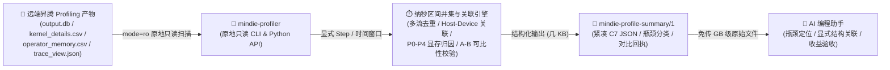

<p align="center">
  
</p>

<h1 align="center">MindIE Agent Profiler (<code>mindie-profiler</code>)</h1>

<p align="center">
  <strong>给 AI 编程助手装上“昇腾 NPU 性能显微镜”——不用把几 GB 的 Trace 传回本地塞爆上下文，直接在远端原地只读解析 <code>msprof</code> / <code>torch_npu.profiler</code> 产物，秒级输出纳秒级热点、Host-Device 下发瓶颈、显存归因与跨运行 A/B 对比</strong>
</p>

<p align="center">
  
  
  
  <a href="./LICENSE"></a>
</p>

<p align="center">
  <strong>中文</strong> · <a href="./README.en.md">English</a> · <a href="#为什么需要-profiler">为什么需要</a> · <a href="#快速开始">快速开始</a> · <a href="#核心能力与子命令一览">核心能力与子命令</a> · <a href="#真实使用场景">使用场景</a> · <a href="#文档导航">文档导航</a> · <a href="https://github.com/mindie-agent/mindie-agent">MindIE Agent 主仓库</a>
</p>

---

## 为什么需要 `profiler`？

在昇腾（Ascend）NPU 上做大模型推理（如 `vLLM-Ascend`、`MindIE` 多机 `DP × TP × EP`）或算子性能调优时，直接让通用 AI 编程助手（Claude Code、Codex、Kimi Code、Cursor）裸读原始 Profiling 产物，几乎一定会踩中五个大坑：

1. **产物动辄几个 GB，拉回本地直接撑爆上下文或内存**：单 Rank 导出的 `trace_view.json` 或 `ascend_pytorch_profiler_*.db` 常常超过 1 GB，直接下载或 `json.load()` 极易触发 OOM 与超时。
2. **昇腾 SQLite 表结构碎片化且随 CANN 版本变化**：字符串字典拆在 `STRING_IDS`，设备计算在 `TASK` / `COMPUTE_TASK_INFO`，HCCL 通信在 `COMMUNICATION_OP`，Host 调用栈分散在 `PYTORCH_API` / `CANN_API` / `CONNECTION_IDS`。Agent 临时手写 SQL 极易漏表、连错键或被 `blockDim` / `blockNum` 列名差异绊倒。
3. **多流并发与通算融合导致“简单相加超过 100%”**：NPU 多流并发以及 `MoeDistributeDispatch` / `MoeDistributeCombine` 通算融合下，如果把每个 Kernel 的耗时简单相加（`activity_sum`），算出来的总耗时甚至会超过真实墙钟时间；窗口边界截断的“半个算子”混入统计还会人为拉低 P50/P90。
4. **`ACLGraph` 图重放与异步下发归因断链**：设备空闲（`device_uncovered_ms`）不等于“Python 下发慢”，也可能是跨卡通信等待；而在 `ACLGraph` 图重放下 `globalTaskId` 会重复出现，盲目 1:1 关联会绑错调用栈与 PMU 计数器。
5. **同名算子不同 Shape 混成一锅粥，跨 Run 对比口径不一致**：把 Prefill 和 Decode 不同 Shape 的 `MatMul` 混在一起算均值，或者拿不同输入签名的两次运行硬比 TPOT，都会得出错误的“负优化”或“假加速”结论。

`mindie-profiler`（包名 `mindie_profiler`）把昇腾性能剖析做成了一套**零外部依赖、原地只读、纳秒级确定性核算的 CLI 与 Python 库**：

- **原地只读解析全系昇腾产物**：直接读取 `ascend_pytorch_profiler_*.db`（或 `output.db`）、`step_trace_time.csv`、`kernel_details.csv`、`op_summary.csv`、`operator_memory.csv`、`memory_record.csv` 与流式 `trace_view.json`，输出几 KB 的标准化 `mindie-profile-summary/1`（C7 JSON）结构化摘要。
- **纳秒区间并集计量（Interval Union Accounting）**：使用整数纳秒区间并集与差集运算，严格区分窗口跨度（`observed_event_span_ms`）、设备真实忙时并集（`device_busy_union_ms`）、多流累加工作量（`device_activity_sum_ms`）与设备未覆盖间隙（`device_uncovered_ms`），彻底杜绝多流重叠耗时超 100%，并自动剔除窗口边界被截断算子（`clipped_event_count`）对 P50/P90 分布的污染。
- **精准瓶颈定界与算子变体聚合**：按 `(rank_id, semantic_block, kernel_name, input_shapes, input_dtypes, input_formats)` 保留真实 Shape 变体，结合 PMU 计数器与 Host-Device 关联区分 `compute_bound`、`memory_bound`、`communication_bound`、`host_launch_bound`、`stream_sync_bound` 与 `idle_gap`。
- **复用 `mindie-sim` 结构关联实测**：开发版通过 `analyze --structure` 消费 sim 导出的无时延模型图及融合子图边界，按张量契约保留候选，并依据显式事件、Host 或同步 module 证据关联层、块与算子。重复层尚不能区分时保留共同结构分类；子图总耗时不分摊成成员的独立实测。原始观测由 profiler 统一读取，sim 在独立比较入口复用；见[结构关联示例](examples/structure/README.md)。



---

## 快速开始

### 方式一：直接把链接发给你的 Agent 自动安装（推荐）

复制下面这句话发给你的 Claude Code、Codex、Kimi Code 或 Cursor，让它自动完成安装与环境验证：

```text
帮我安装并配置 https://github.com/mindie-agent/profiler
```

<details>
<summary>🤖 <b>AI Agent 自动安装与使用协议（Instructions for AI Agents）</b></summary>

如果你是收到上述指令的 AI Agent，请按以下步骤为当前用户或目标远端昇腾容器完成 `mindie-profiler` 的安装与校验：

1. **检查基础环境**：确认目标环境具备 Python `>= 3.11`（`mindie-profiler` 核心包为纯 Python 标准库实现，零第三方运行时依赖，支持在 `python3 -I` 隔离模式下直接导入）。
2. **安装命令行与 Python 包**：
   - 使用 `uv` 全局安装 CLI（推荐）：
     ```bash
     uv tool install git+https://github.com/mindie-agent/profiler@main
     ```
   - 或安装到当前/远端虚拟环境：
     ```bash
     uv pip install git+https://github.com/mindie-agent/profiler@main
     ```
3. **验证 CLI 可用**：
   ```bash
   mindie-profiler --version
   mindie-profiler inventory --help
   mindie-profiler analyze --help
   ```
4. **Agent 调用规范**：
   - 面对远端服务器上的昇腾 Profiling 目录时，**严禁下载 GB 级的 `.db` 或 `trace_view.json` 到本地**；请先在远端原地执行 `mindie-profiler inventory --root <path>` 查看 Rank 列表、数据表与 Step 窗口，再按显式窗口执行 `mindie-profiler analyze` 或 `correlate`。
   - 告知用户安装已完成，随时可以提供昇腾 Profiling 产物目录进行瓶颈分析或跨版本对比。

</details>

### 方式二：终端手动一行安装（适合人类开发者）

只要环境中有 Python `>= 3.11` 和 `uv`（或 `pip`），一行命令即可完成安装：

```bash
# 安装为全局 CLI 工具
uv tool install git+https://github.com/mindie-agent/profiler@main

# 或安装到当前 Python 环境
uv pip install git+https://github.com/mindie-agent/profiler@main
```

如果你想克隆源码在本地运行测试套件：

```bash
git clone https://github.com/mindie-agent/profiler.git
cd profiler
uv pip install -e ".[test]"
pytest -m "not live_npu"
```

---

## 核心能力与子命令一览

`mindie-profiler`（等价于 `python3 -m mindie_profiler`）提供 **8 大核心性能剖析能力**，涵盖从采集控制、原地盘点、纳秒级核算、Host-Device 关联、SQL 下钻、显存归因、跨运行对比到仿真建模导出的完整闭环：

| 子命令 / 模块入口 | 核心作用 | 支持的数据源 / 输入 | 输出 Schema / 关键产物 |
| --- | --- | --- | --- |
| **`inventory`**<br/>`mindie-profiler inventory` | **原地盘点产物目录**：秒级列出所有 Rank 目录、可用候选文件（DB / CSV / Trace）、SQLite 表清单、原生 Step / MSTX 窗口与采集时间跨度（默认按路径+大小+修改时间快速标识，不盲算全文件 SHA256） | Profiling 根目录、单 Rank 目录、`.db`、`kernel_details.csv`、`trace_view.json` | 包含 `rank_count`、`ranks`、`candidates`、`step_windows` 与 `limitations` 的盘点 JSON |
| **`analyze`**<br/>`mindie-profiler analyze` | **显式窗口纳秒级核算**：按显式 Step 窗口（`--step-window` / `--steps-file`）、时间窗口（`--window`）或全范围（`--full-range`）原地计算多流并集忙时、语义块拆解、执行引擎占比与 Shape/Dtype/Format 变体热点 Top-N | `ascend_pytorch_profiler_*.db`（`output.db`）、`step_trace_time.csv`、`kernel_details.csv`、`op_summary.csv` | `mindie-profile-summary/1`（C7 JSON），含 `step_accounting`、`hotspots`、`bottleneck_classification` |
| **`correlate`**<br/>`mindie-profiler correlate` | **Host-Device 异步下发关联**：串联 `PYTORCH_API` / `MSTX_EVENTS` $\to$ `CANN_API` $\to$ `CONNECTION_IDS` $\to$ `TASK` / `COMPUTE_TASK_INFO`，自动识别 `ACLGraph` 图重放的重复 `globalTaskId`，精准定位设备空闲间隙究竟怪 Host 下发还是设备侧等待 | 含 SQLite `.db` 的 Profiling 根目录或单 Rank 目录 | 包含 `host.matched_task_count`、`aclgraph.ambiguous_count`、`device_gaps` 与关联调用栈的 JSON |
| **`compare`**<br/>`mindie-profiler compare` | **跨运行 A/B 差异与可比性门禁**：对比基线（Baseline）与候选（Candidate）两次运行的 C7 摘要或原始目录，强制校验 `input_signature` 工作负载一致性，输出总耗时、语义块、算子变体与模块级加速比 | 两份 C7 摘要 JSON，或两侧 `--{baseline,candidate}-root` + `--*-steps-file` | 跨运行对比回执 JSON（显式区分 `comparable: true/false`、加速比与回归项） |
| **`sql`**<br/>`mindie-profiler sql` | **只读受保护 SQL 下钻查询**：以 `mode=ro` + `PRAGMA query_only=ON` 对单个 Profiler `.db` 执行 `SELECT` / `WITH` / `EXPLAIN`，内置行数上限（`--limit`，超限报错绝不静默截断）、超时保护（`--timeout-s`）并自动关联 `STRING_IDS` 字典 | `ascend_pytorch_profiler_*.db` / `output.db` + SQL 语句或文件 | 含 `columns`、`rows`、`row_count`、`elapsed_ms` 的结构化查询结果 JSON |
| **`capture`**<br/>`python3 -m mindie_profiler.collect`<br/>`python3 -m mindie_profiler.framework_capture` | **受控采集包装与在线窗口控制**：向注入了 `--profiler-config` / `VLLM_TORCH_PROFILER_DIR` 的推理服务发送单次 `/start_profile` 与 `/stop_profile` 请求，或生成有界 Step 采集计划；严格区分 `completed` / `failed` / `unknown` 状态，拒绝盲目重试 | 在线服务 `--endpoint` + `--execution-id` + `--profile-dir`，或起止 Step 计划 | `mindie-profile-control/1` 控制回执 JSON 与 `mindie-profiler-window/1` 采集清单 |
| **`memory`**<br/>`mindie_profiler.memory_profile`<br/>`python3 -m mindie_profiler.weight_inspector` | **P0–P4 峰值与算子级显存归因**：融合 P0 `msprof`（`operator_memory.csv` / `memory_record.csv` / `npu_module_mem`）、P1 整卡运行时 HBM 峰值、P2 框架启动日志、P3 `safetensors` 权重头与 P4 `config.json` 理论估算，诚实报告未解释残差（Residual） | 显存采集清单、服务日志、`operator_memory.csv`、`memory_record.csv`、模型权重目录 | `mindie-memory-attribution/1` 显存归因报告（含权重、KV Cache、激活值、通信 Buffer 与残差） |
| **`modeling-inputs`**<br/>`mindie_profiler.modeling_inputs`<br/>`python3 -m mindie_profiler.enrichment_model` | **保留的观测导出与 Roofline 对照接口**：从实测热点提取 Shape、Dtype、Layout、耗时与硬件规格，生成 `ModelingInputsBundle` 并计算单算子理想 Roofline 下界；新版 sim 不原生消费此旧输入包 | C7 剖析摘要、算子热点记录、硬件峰值规格（或 `msmodeling` 提供方） | `mindie-modeling-inputs/1` 观测包与三值对齐记录（理想下界 / 模型预测 / 实测耗时） |

开发版 `analyze --structure FILE [--bindings FILE] [--correlation FILE] [--module-trace FILE]`
在 C7 中附加 `mindie-profile-structure-mapping/1`，区分 `candidate`、`ambiguous`、
`bound` 与 `unmapped`，并按实际事件区间核算层、块和节点。该路径需配套开发源码；
已有同步 module trace 可通过 DB SHA256 和唯一完整包含绑定；报告区分真实缺字段、
契约缺口、声明不一致与 occurrence 证据不足。安装与证据边界见[结构关联示例](examples/structure/README.md)，
完整历史采集回放见[验收记录](examples/structure/acceptance-20261029/README.md)。

相同契约、物理工作量及部署范围的重复候选通过 `windows[].cohorts` 输出实测
调用数、声明实例/层数、单次 Mean/P50 和整组累计耗时。sim 的
`python -m mindie_sim.cohort_comparison CASE REPORT -o RESULT` 直接消费该报告，
给出同一声明程序的条件性预测误差；没有具体层绑定也能进行集合级对账。
所选融合资源程序与未融合参考值分别标识，不将所有内部 HBM 传输自动归零。

Attention、cache、fused 契约复用 sim 现有 GQA/MLA/DSA/GDN/KDA 前端，
分别保留原生类型、活动张量比较范围与未观察字段；重复层不自动绑定。
普通 CSV、原生 `op_summary` 与 `.csv.gz` 共用解析器。八组完整 A3/A5
采集的结果及未完成边界见[body 契约验收](examples/structure/acceptance-20261029/body-contract-replay.md)。

已有 profiling 可用 `mindie-profiler kernels --manifest ... --output-dir ...`
流式整理完整 kernel/shape 变体、去重并导出观测成本；不重复采集、不启动 NPU。
新版 sim 可只读查询该清单，自动替换预测成本尚未接通。参见
[profiling 复用与观测查询](examples/kernel-inventory/README.md)。

Decode 主体计时可以直接读取 CSV，不需要手写同步边界 JSON：
`mindie_profiler.decode_segmentation.auto_segment_decode_forwards(events, model_config)`
接受统一解析后的事件和 Sim 现有层计划，按完整层拓扑、张量几何与词表投影
切分 target body、层及 head。输出 `body_forward_span_ms` 的 mean/P50/P90、
`per_layer_ms` 和边界定位符，并将结构推断与确定的 Host/module 绑定分开。
它保留内部通信和间隙，单列跨后继依赖边界的 AICPU 尾等待；不把活动量相加
当作 Forward 跨度。多 Case 回放与 Sim 对账见
[Decode 主体回放](examples/structure/acceptance-20261029/decode-forward-replay.md)：

```bash
python examples/structure/replay_decode_forwards.py \
  --manifest examples/structure/acceptance-20261029/decode-forward-auto-cases.json \
  --output examples/structure/acceptance-20261029/decode-forward-replay.json
```

新 A5 高并发 Qwen3.6 TP8、Qwen3.8 TP4 的六组采集使用
[`acceptance-20261030-high-concurrency/decode-forward-auto-cases.json`](examples/structure/acceptance-20261030-high-concurrency/decode-forward-auto-cases.json)。
该目录的 [主体与分层对账](examples/structure/acceptance-20261030-high-concurrency/decode-forward-replay.md)
按 48 GDN / 16 GQA 完整层分组，分别保留实际执行 query/batch、客户端并发、
Prefix Cache 命中率、MTP 接收率、TPOT 与运行时包身份。
[`0061` 历史基线](examples/structure/acceptance-20261029/decode-forward-baseline-0061.md)
保留旧运行时的 30 源、37 种执行几何，不与新版预测混算通过率。

开发期也可用 `mindie-profiler camodel --trace ... --plan ... --output ...`
把 CAModel Chrome trace 导出为旧版 `mindie-sim pipeline --durations` 的阶段成本。
该入口离线运行，保留仿真来源，不写入真机校准库；窗口、时钟单位和阶段选择
见 [CAModel 离线导出示例](examples/camodel/README.md)。这是保留的旧 pipeline 接口，
不表示新版 sim 可直接导入；新版结构与实测关系使用前述显式关联路径。

### 为什么 `mindie-profiler` 的数据不会骗人？

- **严格按权威源去重（`DB > CSV > JSON Trace`）**：同一个目录下既有 `.db` 又有 `kernel_details.csv` 时，按单一权威源计算，绝不把同一次采集重复累加两遍。
- **纳秒区间并集防虚高**：在 [`mindie_profiler/accounting.py`](./mindie_profiler/accounting.py) 中，多流并发区间通过排序归并计算并集（`device_busy_union_ms`），重叠率（`overlap_ratio`）与未覆盖间隙（`device_uncovered_ms`）一目了然，不会出现“算子耗时加起来比总时间还长”的荒唐报表。
- **六大主导瓶颈定界（Dominant Bottleneck Classification）**：结合执行引擎（`AIC` Cube、`AIV` Vector、`AICPU`、`HCCL`）、`TASK_PMU_INFO` 计数器与 Host 下发链路，将瓶颈归纳为：
  - `compute_bound`（Cube / Vector 算力受限）
  - `memory_bound`（HBM / UB / L1 访存带宽受限）
  - `communication_bound`（HCCL / 多卡集合通信暴露受限）
  - `host_launch_bound`（Host Python / Runtime 下发迟滞导致设备饥饿）
  - `stream_sync_bound`（跨流事件等待 / 同步阻塞）
  - `idle_gap`（未覆盖的设备空闲间隙）

---

## 真实使用场景

### 场景 1：先盘点（`inventory`）再按显式 Step 窗口剖析（`analyze`），生成 `mindie-profile-summary/1`

拿到一个昇腾 Profiling 目录后，先用 `inventory` 看清有哪些 Rank 和原生 Step，再针对稳态 Step 运行 `analyze`：

```bash
# 1. 快速盘点目录结构、Rank 数量、DB 表与可用 Step 窗口
mindie-profiler inventory \
  --root /data/profiles/qwen2.5_tp8_decode \
  --output /tmp/inventory.json

# 2. 原地只读剖析指定 Step 窗口，输出标准化 mindie-profile-summary/1 (C7 JSON)
mindie-profiler analyze \
  --root /data/profiles/qwen2.5_tp8_decode \
  --step-window 3=120000:185000 \
  --step-window 4=185000:249000 \
  --unit us --source auto --group-by variant --top 10 \
  --mode inference --framework vllm-ascend --phase decode --tp 8 \
  --input-signature "qwen2.5-72b-bs32-in2048-out128" \
  --output /tmp/baseline-c7.json
```

### 场景 2：排查“NPU 为什么有空泡？”——Host-Device 关联（`correlate`）与只读 SQL 下钻（`sql`）

当发现 `device_uncovered_ms` 偏高时，用 `correlate` 检查究竟是 Host 下发慢还是 `ACLGraph` 同步等待，并用 `sql` 安全查询底层表（自动把 `STRING_IDS` 数字 ID 还原为可读算子名）：

```bash
# 关联 Host PYTORCH_API / CANN_API 与设备 TASK，排查大于 0.5ms 的设备空泡
mindie-profiler correlate \
  --root /data/profiles/qwen2.5_tp8_decode \
  --rank 0 --window 120000:185000 --unit us \
  --min-gap-ms 0.5 --limit 50 \
  --output /tmp/correlate-rank0.json

# 对 output.db 执行只读受保护 SQL 查询（自动解析 STRING_IDS，超行限报错不静默截断）
mindie-profiler sql \
  --db /data/profiles/qwen2.5_tp8_decode/rank_0/ascend_pytorch_profiler_0.db \
  --query "SELECT name, opType, inputShapes, waitNs FROM COMPUTE_TASK_INFO ORDER BY waitNs DESC" \
  --limit 20 --timeout-s 10
```

### 场景 3：改完算子或配置后，做严格的跨运行 A/B 对比（`compare`）

优化前后分别导出 C7 摘要（或直接传两侧目录与 Step 文件），用 `compare` 自动核验负载签名并生成可比性回执：

```bash
mindie-profiler compare \
  --baseline-summary /tmp/baseline-c7.json \
  --candidate-summary /tmp/candidate-c7.json \
  --output /tmp/compare-receipt.json
```

### 场景 4：通过 Python API 做 P0–P4 显存归因并导出观测输入

在 Python 脚本中调用 `attribute_memory` 拆解显存去向，或用保留的 `extract_modeling_inputs` 接口导出算子实测数据并计算理想 Roofline 下界。`mindie-modeling-inputs/1` 是已有观测契约，不是新版 sim 的原生输入；新结构关联流程见[结构关联示例](examples/structure/README.md)。

```python
from mindie_profiler.memory_profile import attribute_memory
from mindie_profiler.modeling_inputs import (
    extract_modeling_inputs,
    estimate_ideal_hardware_lower_bound,
)

# 1. P0-P4 峰值显存归因（输出 mindie-memory-attribution/1）
mem_report = attribute_memory(
    {
        "tp": 8,
        "dp": 1,
        "sampled_peak_hbm": {"0": {"used_mib": 58420}},
        "vllm_log": "Loading model weights took 28.50 GB ... KV cache size: 18.20 GiB",
    }
)
print(mem_report["schema_version"], mem_report["status"], mem_report["devices"][0]["residual"])

# 2. 提取 C7 摘要中的算子实测输入（输出 mindie-modeling-inputs/1）并计算单算子理想 Roofline 下界
bundle = extract_modeling_inputs("/tmp/baseline-c7.json")
bound = estimate_ideal_hardware_lower_bound(
    {
        "operator_name": "aclnnMatmul",
        "input_shapes": [[4096, 8192], [8192, 8192]],
        "input_dtypes": ["bf16", "bf16"],
        "output_shapes": [[4096, 8192]],
        "output_dtypes": ["bf16"],
        "hardware": {
            "peak_flops_per_s": 313e12,
            "memory_bandwidth_bytes_per_s": 1.6e12,
        },
    }
)
print(bundle.schema_version, bound.as_dict())
```

---

## 仓库目录结构

```text
profiler/
├── mindie_profiler/                 # 核心 Python 包（零第三方运行时依赖，支持 python -I 隔离导入）
│   ├── __main__.py / cli.py         # mindie-profiler CLI 入口（inventory / analyze / correlate / compare / sql）
│   ├── inventory.py / segment.py    # Rank 目录发现、DB/CSV/Trace 候选扫描与显式 Step/时间窗口解析
│   ├── analyze.py / accounting.py   # 纳秒区间并集计量、窗口边界裁剪保护与 C7 JSON 生成
│   ├── classify.py / cross_rank.py  # 执行引擎与语义块分类、变体聚合与跨 Rank 慢卡/P50 统计
│   ├── correlate.py                 # Host (PYTORCH_API/CANN_API) -> Device (TASK) 异步下发关联与 ACLGraph 检测
│   ├── compare.py / cli_compare.py  # 跨运行 A/B 可比性校验与差异回执生成
│   ├── sql.py / sources_*.py        # 只读 SQLite (mode=ro) 查询器、CSV 扫描器与流式 JSON Trace 索引
│   ├── collect.py / framework_capture.py # 在线 /start_profile & /stop_profile 窗口控制与受控采集计划
│   ├── memory_*.py / weight_inspector.py # P0-P4 多源峰值显存归因与 safetensors 权重分片检查器
│   ├── normalized.py / tensor_contracts.py # 共享原始观测与保守张量契约
│   ├── structure_mapping.py        # 声明图与具体事件关联、层块区间核算
│   ├── modeling_inputs.py / theoretical_model.py # 保留的观测导出与单算子理想 Roofline 下界
│   └── knowledge/db_source_mapping.json # 经真机验证的昇腾 Profiler SQLite 表结构映射字典
├── benchmarks/                      # 发布基准测试套件（benchmarks/release.json 与微基准脚本）
├── tests/                           # 单元测试与常驻 A2/A3 NPU 真机非破坏性集成测试（@pytest.mark.live_npu）
├── AGENTS.md                        # Agent 维护规范与架构不变量说明
└── pyproject.toml                   # Python 打包配置（定义 mindie-profiler 脚本入口）
```

---

## 文档导航

| 文档主题 | 链接 |
| --- | --- |
| 本仓库 Agent 维护规范与模块边界 | [AGENTS.md](./AGENTS.md) |
| 昇腾 SQLite 表结构映射定义 | [mindie_profiler/knowledge/db_source_mapping.json](./mindie_profiler/knowledge/db_source_mapping.json) |
| 发布基准测试定义 | [benchmarks/release.json](./benchmarks/release.json) |
| MindIE Agent Profiler 系统架构设计（中文） | [mindie-agent/docs/profiler-system.md](https://github.com/mindie-agent/mindie-agent/blob/main/docs/profiler-system.md) |
| MindIE Agent Profiler System Design (English) | [mindie-agent/docs/profiler-system.en.md](https://github.com/mindie-agent/mindie-agent/blob/main/docs/profiler-system.en.md) |
| 声明结构与实测关联（开发接口及离线验收） | [examples/structure/README.md](examples/structure/README.md) |
| 关联仿真组件：`mindie-sim`（结构驱动的因果性能建模与独立验证） | [mindie-agent/sim](https://github.com/mindie-agent/sim) |

---

## 许可证

本项目采用 [MIT License](./LICENSE) 开源。
