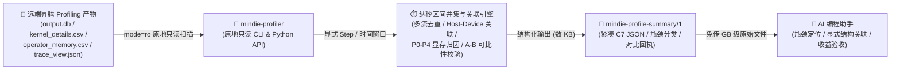

<p align="center">
  
</p>

<h1 align="center">MindIE Agent Profiler (<code>mindie-profiler</code>)</h1>

<p align="center">
  <strong>给 AI 编程助手装上“昇腾 NPU 性能显微镜”——无需把数 GB 的 Trace 拉回本地撑爆上下文，直接在远端原地只读解析 <code>msprof</code> / <code>torch_npu.profiler</code> 产物，秒级输出纳秒级区间核算、Host-Device 下发关联、显存归因与跨运行 A/B 对比</strong>
</p>

<p align="center">
  
  
  
  
  <a href="./LICENSE"></a>
</p>

<p align="center">
  <strong>中文</strong> · <a href="./README.en.md">English</a> · <a href="#为什么需要-profiler">为什么需要</a> · <a href="#快速开始">快速开始</a> · <a href="#核心能力与子命令一览">核心能力与子命令</a> · <a href="#真实使用场景">使用场景</a> · <a href="#文档导航">文档导航</a> · <a href="https://github.com/mindie-agent/mindie-agent">MindIE Agent 主仓库</a>
</p>

---

## 为什么需要 `profiler`？

在昇腾（Ascend）NPU 上调优大模型推理（如 `vLLM-Ascend`、`MindIE` 多机 `DP × TP × EP`）或自定义算子时，让通用 AI 编程助手（Claude Code、Codex、Kimi Code、Cursor）直接读取原始 Profiling 产物，往往会撞上五类典型问题：

1. **产物动辄数 GB，拉回本地直接撑爆上下文或内存**：单 Rank 导出的 `trace_view.json` 或 `ascend_pytorch_profiler_*.db` 常常超过 1 GB，直接下载或执行 `json.load()` 极易触发 OOM 与超时。
2. **昇腾 SQLite 表结构碎片化且随 CANN 版本演进**：字符串字典存放在 `STRING_IDS`，设备计算任务在 `TASK` / `COMPUTE_TASK_INFO`，HCCL 集合通信在 `COMMUNICATION_OP`，Host 调用栈分散在 `PYTORCH_API` / `CANN_API` / `CONNECTION_IDS`。临时手写 SQL 很容易漏连表、解错字典 ID，或被 `blockDim` / `blockNum` 等跨版本列名差异绊倒。
3. **多流并发与通算融合导致“简单相加超过 100%”**：在 NPU 多流并发及 `MoeDistributeDispatch` / `MoeDistributeCombine` 通算融合场景下，把单个 Kernel 耗时简单相加（`activity_sum`）会超过真实墙钟时间；窗口边界被截断的“半个算子”混入统计还会人为拉低 P50/P90。
4. **`ACLGraph` 图重放与异步下发导致归因断链**：设备空闲（`device_uncovered_ms`）未必是 Python 下发慢，也可能是跨卡通信或流间事件等待；而在 `ACLGraph` 图重放模式下 `globalTaskId` 会重复出现，按 1:1 盲目关联会绑错调用栈与 PMU 计数器。
5. **同名算子不同 Shape 混算均值，跨运行对比口径不一致**：把 Prefill 与 Decode 阶段不同 Shape 的 `MatMul` 混在一起算均值，或拿输入签名不一致的两次运行直接比 TPOT，都会得出失真的优化结论。

`mindie-profiler`（Python 包名 `mindie_profiler`）将昇腾性能剖析收敛为一套**原地只读、纳秒级确定性核算的 CLI 与 Python 库**：

- **原地只读解析全系昇腾产物**：直接读取 `ascend_pytorch_profiler_*.db`（或 `output.db`）、`step_trace_time.csv`、`kernel_details.csv`、`op_summary.csv`、`operator_memory.csv`、`memory_record.csv` 与流式 `trace_view.json`，输出数 KB 的标准化 `mindie-profile-summary/1`（C7 JSON）摘要。
- **纳秒区间并集计量（Interval Union Accounting）**：使用整数纳秒区间并集与差集运算，严格区分窗口跨度（`observed_event_span_ms`）、设备真实忙时并集（`device_busy_union_ms`）、多流活动总和（`device_activity_sum_ms`）与设备未覆盖间隙（`device_uncovered_ms`），消除多流重叠导致的耗时虚高，并自动剔除窗口边界截断事件（`clipped_event_count`）对单次耗时分位数的干扰。
- **保留 Shape 变体的热点聚合与瓶颈定界**：按 `(rank_id, semantic_block, kernel_name, input_shapes, input_dtypes, input_formats)` 聚合算子变体，结合 PMU 计数器与 Host-Device 关联区分 `compute_bound`、`memory_bound`、`communication_bound`、`host_launch_bound`、`stream_sync_bound` 与 `idle_gap`。
- **与 `mindie-sim` 共享模型结构与实测归因（`mindie-model-structure/1`）**：通过 `analyze --structure` 消费 `mindie-sim` 导出的模型图与融合子图边界，将设备算子归因到模型层、结构块（Attention / MLA / GDN / KDA / MoE / mHC）与同构算子群（`cohorts`），并支持按完整层拓扑自动切分 Decode / Prefill 前向窗口（`auto_segment_decode_forwards`）。详见[结构关联与验证指南](examples/structure/README.md)。



---

## 快速开始

直接复制下面这句话发给你的 Claude Code、Codex、Kimi Code、DeepSeek Harness（DSH）或 Google Antigravity（AGY），由 AI Agent 自动完成安装与环境验证：

```text
帮我安装并配置 https://github.com/mindie-agent/profiler
```

<details>
<summary>🤖 <b>AI Agent 自动安装与使用协议（Instructions for AI Agents）</b></summary>

如果你是收到上述指令的 AI Agent，请按以下步骤为当前环境或目标远端昇腾容器完成 `mindie-profiler` 的安装与校验：

1. **检查基础环境**：确认目标环境具备 Python `>= 3.11`（基础事件核算仅依赖 Python 标准库，安装包配套依赖 `mindie-sim >= 0.9.3`；基础 CLI 不会加载模型权重或初始化 NPU 设备上下文）。
2. **安装命令行与 Python 包**：
   - 使用固定版本 Release Wheel 安装（推荐生产环境）：
     ```bash
     uv pip install \
       https://github.com/mindie-agent/sim/releases/download/v0.9.10/mindie_sim-0.9.10-py3-none-any.whl \
       https://github.com/mindie-agent/profiler/releases/download/v0.5.11/mindie_profiler-0.5.11-py3-none-any.whl
     ```
   - 或从源码主分支安装最新开发版：
     ```bash
     uv tool install git+https://github.com/mindie-agent/profiler@main
     ```
3. **验证 CLI 可用**：
   ```bash
   mindie-profiler --version
   mindie-profiler inventory --help
   mindie-profiler analyze --help
   ```
4. **Agent 调用规范**：
   - 面对远端服务器上的昇腾 Profiling 目录时，**严禁将 GB 级的 `.db` 或 `trace_view.json` 下载到本地**；请先在远端原地执行 `mindie-profiler inventory --root <path>` 查看 Rank 列表、数据表与 Step 窗口，再按显式窗口执行 `mindie-profiler analyze` 或 `correlate`。
   - 告知用户安装已完成，随时可以提供昇腾 Profiling 产物目录进行瓶颈分析或跨版本对比。

</details>

---

## 核心能力与子命令一览

`mindie-profiler`（等价于 `python3 -m mindie_profiler`）覆盖从稳态采集、原地盘点、纳秒级核算、Host-Device 关联、受保护 SQL 查询、显存归因、跨运行对比到仿真用例导出的完整闭环：

| 子命令 / 模块入口 | 核心作用 | 支持的数据源 / 输入 | 输出 Schema / 关键产物 |
| --- | --- | --- | --- |
| **`inventory`**<br/>`mindie-profiler inventory` | **原地盘点产物目录**：秒级列出所有 Rank 目录、候选文件（DB / CSV / Trace）、SQLite 表清单、原生 Step / MSTX 窗口与采集时间跨度（默认按路径+大小+修改时间快速标识，不盲算大文件 SHA256） | Profiling 根目录、单 Rank 目录、`.db`、`kernel_details.csv`、`trace_view.json` | 包含 `rank_count`、`ranks`、`candidates`、`step_windows` 与 `limitations` 的盘点 JSON |
| **`analyze`**<br/>`mindie-profiler analyze` | **显式窗口纳秒级核算**：按显式 Step 窗口（`--step-window` / `--steps-file`）、时间窗口（`--window`）或全范围（`--full-range`）计算多流并集忙时、语义块拆解、执行引擎占比与 Shape/Dtype/Format 变体热点 Top-N | `ascend_pytorch_profiler_*.db`（`output.db`）、`step_trace_time.csv`、`kernel_details.csv`、`op_summary.csv` | `mindie-profile-summary/1`（C7 JSON），含 `step_accounting`、`hotspots`、`bottleneck_classification` |
| **`correlate`**<br/>`mindie-profiler correlate` | **Host-Device 异步下发关联**：串联 `PYTORCH_API` / `MSTX_EVENTS` $\to$ `CANN_API` $\to$ `CONNECTION_IDS` $\to$ `TASK` / `COMPUTE_TASK_INFO`，识别 `ACLGraph` 图重放下的重复 `globalTaskId`，定位设备空闲间隙源于 Host 下发还是设备侧等待 | 含 SQLite `.db` 的 Profiling 根目录或单 Rank 目录 | 包含 `host.matched_task_count`、`aclgraph.ambiguous_count`、`device_gaps` 与关联调用栈的 JSON |
| **`compare`**<br/>`mindie-profiler compare` | **跨运行 A/B 差异与可比性门禁**：对比基线与候选两次运行的 C7 摘要或原始目录，强制校验 `input_signature` 负载一致性，输出总耗时、语义块、算子变体与模块级加速比 | 两份 C7 摘要 JSON，或两侧 `--{baseline,candidate}-root` + `--*-steps-file` | `mindie-profile-comparison/1` 对比回执（显式区分 `comparable: true/false`、加速比与回归项） |
| **`sql`**<br/>`mindie-profiler sql` | **只读受保护 SQL 下钻查询**：以 `mode=ro` + `PRAGMA query_only=ON` 对单个 Profiler `.db` 执行 `SELECT` / `WITH` / `EXPLAIN`，内置行数上限（`--limit`，超限报错绝不静默截断）、超时保护（`--timeout-s`）并自动还原 `STRING_IDS` | `ascend_pytorch_profiler_*.db` / `output.db` + SQL 语句或文件 | 含 `columns`、`rows`、`row_count`、`elapsed_ms` 的结构化查询结果 JSON |
| **`capture`**<br/>`mindie-profiler capture`<br/>`python3 -m mindie_profiler.collect` | **CANN 9.x 稳态采集与在线窗口控制**：支持双挡位原生稳态采集（`fast` MSPTI / `deep` aclprof + C7）及在线服务 `/start_profile`、`/stop_profile` 单次窗口控制；严格区分 `completed` / `failed` / `unknown` 状态，拒绝盲目重试 | 目标启动命令、`--attach` 会话 ID，或在线服务 `--endpoint` + `--execution-id` | `mindie-native-capture/1` 采集回执、`mindie-profile-control/1` 控制回执与窗口计划 |
| **`memory`**<br/>`mindie_profiler.memory_profile`<br/>`python3 -m mindie_profiler.weight_inspector` | **P0–P4 峰值与算子级显存归因**：融合 P0 `msprof`（`operator_memory.csv` / `memory_record.csv` / `npu_module_mem`）、P1 整卡运行时 HBM 峰值、P2 框架启动日志、P3 `safetensors` 权重头与 P4 `config.json` 理论估算，诚实报告未解释残差 | 显存采集清单、服务日志、`operator_memory.csv`、`memory_record.csv`、模型权重目录 | `mindie-memory-attribution/1` 显存归因报告（含权重、KV Cache、激活值、通信 Buffer 与残差） |
| **`export-sim-case` / `modeling-inputs`**<br/>`mindie-profiler export-sim-case`<br/>`mindie_profiler.modeling_inputs` | **仿真 Case 导出与 Roofline 对照**：`export-sim-case` 将完整实测元数据与观测摘要导出为五键 `mindie-sim` Case；`modeling_inputs` 保留单算子观测包导出与理想 Roofline 下界估算（当前 `mindie-sim` 通过 `mindie-model-structure/1` 与 Case 接口对接，不直接读取旧版 `ModelingInputsBundle`） | 采集目录 / C7 摘要 / 运行元数据 JSON、热点记录与硬件峰值规格 | `mindie-profiler-sim-bridge/1` 仿真用例及 `mindie-modeling-inputs/1` Roofline 对照记录 |
| **`inspect-op`**<br/>`mindie-profiler inspect-op` | **昇腾算子 C-ABI 签名与槽位查询**：检索内置 CANN `aclnn` / 自定义算子目录，按分页或槽位窗口返回输入张量、标量属性、Workspace 与输出槽位契约 | 算子 API / Kernel 名称、可选 `--cann-version` 与槽位区间 `--span` | `mindie-op-abi-inspect/1` 受限回执 JSON（同时支持 `inspect_op_abi` MCP 工具） |
| **`repro-op`**<br/>`mindie-profiler repro-op` | **单算子内容寻址独立复现器生成**：将实测算子行绑定到精确 ABI 槽位契约，生成自包含 `repro.py` 单算子复现脚本与确定性输入构造规格 | 算子观测 JSON（`--occurrence`）或已有内容寻址句柄（`--resolve`） | `mindie-op-repro-receipt/1` 回执与 `sha256:<64-hex>` 独立复现包 |
| **`fabric-probe`**<br/>`mindie-profiler fabric-probe` | **集群互联带宽探测脚本生成与解析**：生成单文件多卡 HCCL 延迟/带宽微基准脚本，或将实测回执校核为实测互联供给描述 | `--emit-script` 拓扑参数或 `--parse-receipt` 探测输出 JSON | `mindie-fabric-probe/1` 互联供给回执与独立探测脚本 |
| **`op-formula`**<br/>`mindie-profiler op-formula` | **单算子理论物理下界与双层 Roofline 标注**：按算子代数公式计算精确 FLOPs、读写字节数、物理硬下界与实测供给校准下的参考 Roofline 下界，优先拦截超物理速率异常 | 单算子 `--operator` + `--params` + `--sku`，或批量算子明细 `--input` | `mindie-op-formula-mcp/1` 理论下界回执与批量 Roofline 标注 JSON |

### 结构关联、自底向上推断与效率诊断（配套 `mindie-sim 0.9.10`）

当前版本组合 `mindie-profiler v0.5.11` + [`mindie-sim v0.9.10`](https://github.com/mindie-agent/sim) 提供以下结构级分析与离线诊断入口：

- **自底向上无先验结构推断（`mindie-structural-inference/1`）**：`mindie_profiler.structural_inference.infer_trace_structure` 直接从实测算子事件流识别复合融合算子（`fused_composites`）、归并 L2 子图结构块（Attention / MLA / GDN-KDA / MoE / Dense FFN / Norm+Residual）、检测最长重复层周期（`body_topology`），并分离投机解码草稿头（`speculative_module`）。
- **拓扑驱动的结构映射（`analyze --structure`）**：
  ```bash
  mindie-profiler analyze --root <profile_dir> --structure <structure.json> \
    [--bindings <bindings.json>] [--correlation <correlate.json>] [--module-trace <trace.json>]
  ```
  在 C7 报告中嵌入 `mindie-profile-structure-mapping/1`，将设备算子归因到具体结构块与融合子图边界（显式区分 `bound`、`candidate`、`ambiguous` 与 `unmapped`），并在 `windows[].cohorts` 中统计同构算子群的调用次数、单次 Mean/P50 与总体活动量（支持 CSV、`op_summary.csv` 与 `.csv.gz` 流式读取）。
- **自动前向与逐层切分（`auto_segment_decode_forwards`）**：依据完整层计划、张量几何与输出头边界自动识别 Decode / Prefill Body 及逐层耗时，保留层内通信与真实间隙，并将跨步 AICPU 控制尾开销独立归档。
- **整网 4D 效率、反事实 `0.80x MBU` Roofline 与 `30 ms` SLA 硬件缩放报告**：
  ```bash
  python examples/structure/efficiency_report.py \
    --json-out examples/structure/results/efficiency_and_scaling.json
  ```
  输出整网与子图四维效率（`Cube_MFU`、`Vec_MFU`、`MBU`、`Link_Util`、`CV_Overlap`）、`0.80x MBU` 反事实优化空间及 `30 ms` Decode SLA 下 `2x HBM` / `2x Compute` 硬件缩放吞吐上限。
- **补充工具与专家诊断 API**：
  - `mindie-profiler kernels --manifest ... --output-dir ...`：流式构建跨采集去重的 Kernel / Shape 变体目录（见 [`examples/kernel-inventory/README.md`](./examples/kernel-inventory/README.md)）。
  - `mindie-profiler camodel --trace ... --plan ... --output ...`：流式提取开发期 CAModel Chrome Trace 的微阶段有效区间并集，显式标记 `simulated` 来源（见 [`examples/camodel/README.md`](./examples/camodel/README.md)）。
  - **算子调优规则、跨卡慢卡与显存取证 Python API**：提供 `evaluate_advisor_rules`（检测 AICPU 回退、UB/MTE 对齐争用、可融合算子序列、Host 同步/GC 卡顿）、`attribute_cluster_stragglers_and_links` / `evaluate_ep_load_balance`（跨 Rank 慢卡与 MoE EP 负载均衡诊断）以及 `run_memory_forensics` / `detect_step_monotonic_leaks`（Step 单调显存泄漏与碎片取证）。
  - **`ACLGraph` 多流 DAG 与 `A1–A5` 重叠度诊断（`mindie_profiler.aclgraph_mcp`）**：重建捕获与重放阶段的事件依赖 DAG（`reconstruct_aclgraph_dag`），分级诊断多流串行化与重叠损失根因（`diagnose_aclgraph_overlap`），并核算昇腾 `207008` SQ/CQ 队列容量预算与 SuperKernel 设备侧循环融合收益。

### 基准数据集清单与独立精度证据边界

围绕公开基准集 [`maoxx241/mindie-sim-profiling-bench`](https://huggingface.co/datasets/maoxx241/mindie-sim-profiling-bench) 与四级（L1–L4）评估入口，当前版本的证据口径说明如下：

1. **清单规模与原始证据覆盖**：基准清册保留 `731` 条零样本记录与 `6,606` 条集群（fleet）记录，合计 `7,337` 条清单记录（硬件分布为 `A2: 837`、`A3: 1,729`、`A5: 4,771`）。`7,337` 为登记在册的清单条目数，不代表上述结构推断或预测功能在全部条目上的覆盖数或通过数。原始证据仅部分齐备：零样本清单关联 `1,073` 份候选单 Rank Kernel 导出（含 `6` 份与当次测量无关的陈旧窗口，属于候选导出而非已核验的同 Rank 匹配），客户端请求记录覆盖全部 `731` 条零样本条目；集群清单中部分记录保留原生物理 Kernel 明细，其余仅含算子汇总表或客户端回执。
2. **已核实的缺失证据范围**：按各自粒度独立统计，共有 `198` 份 A5 多机导出缺少同 Rank 完整 Kernel 时间线，另有 `27` 个集群服务测试单元（service cell）无成功完成的请求记录（因此缺少已完成请求的 L4 端到端证据）。上述条目均原样保留在清单中并标记为证据缺失，不相互替代，也不使用相邻 Rank 数据或历史存量 `observed_ms` 回填。
3. **历史精度总表的更正说明**：本 README 早期版本曾将该清单表述为“`7,337` 份真实 NPU 采集”，并列出全量 `100.0% <= 10%`、`731/731` 及 `21/21` 等汇总表。经核查，历史基准工件的输入行中混入了由实测目标反向派生的预测输入（包括预测需求量、由实测算子族占比归一化的结构权重、克隆的算子耗时，以及重复或重叠的采集源）。因此，早期全量 `100.0%` 数值仅反映历史工件输出，不构成独立精度证明，相关旧总表已移除；历史发布说明（如 [`docs/releases/profiler-0.5.7.md`](./docs/releases/profiler-0.5.7.md)、[`docs/releases/profiler-0.5.6.md`](./docs/releases/profiler-0.5.6.md)）仅作归档背景保留。
4. **L1–L4 分级验证的输入准则**：
   - **L1（单算子机制）**：必须使用同 Rank `kernel_details.csv` 的逐算子明细（Name、Type、Accelerator Core、Start/Duration、Shape/Dtype 及各流水线时间）。
   - **L2（逐 Step 子图归因）**：必须由同 Rank 逐 Kernel 明细按 `算子类型 × 原生计算核` 聚合；`op_statistic.csv` 仅能用于全程总量核对，不能反推单 Step L2；通信耗时仅取 `kernel_details.csv` 中的 `COMMUNICATION` 行（`op_statistic.csv` 不含 HCCL）。
   - **L3（整网前向时间线）**：需要独立匹配的原生 Rank 与前向窗口，以 Kernel 起止时间定界；采样标记（sampler marker）仅代表候选边界，`step_trace_time.csv` 仅为聚合统计；单次前向观测必须明确区分墙钟跨度（elapsed span）与算子累加耗时（additive mass），二者不可混用。
   - **L4（服务端到端 TTFT/TPOT）**：必须使用原始压测端记录的请求级客户端数据（如 `bin/bench_cell.py` 的 SSE `streams[]` 中 `ttft_s`、`e2e_s`、`completion_tokens`，或集群 `request_summary.csv`）。在未建立请求到设备前向窗口的确定性映射前，不得将 L4 客户端口径与 L1–L3 设备窗口直接混比；仅凭 `kernel_details.csv` / `op_summary.csv` 无法验证 L4。
5. **复现入口与发布准则**：当前尚无经独立验证的全局严格通过结论。各子域独立评估的通过、失败、未覆盖或未知结果均需附带完整保留分母与缺失计数发布：
   ```bash
   # 零样本 L1-L4 单步分段验证入口（保留完整分母，禁用历史回填）
   PYTHONPATH=src:/path/to/sim python3 examples/structure/zero_shot_piecewise_validation.py --no-historical

   # 严格清单门禁入口（按原始清单 ID 与独立观测计分；--strict-10pct 仅启用门禁阈值）
   PYTHONPATH=src:/path/to/sim python3 scripts/hf_profiling_benchmark.py --evaluate --strict-10pct
   ```
   回放管线与数据边界详见 [`examples/structure/README.md`](./examples/structure/README.md)，其中的阶段性结果摘要同样受本节证据边界约束。

### 为什么 `mindie-profiler` 的核算结果可靠？

- **单一权威数据源去重（`DB > CSV > JSON Trace`）**：同一目录下同时存在 `.db` 与 `kernel_details.csv` 时，按单一权威源核算，绝不把同一次采集重复累加。
- **纳秒区间并集防虚高**：在 [`mindie_profiler/accounting.py`](./mindie_profiler/accounting.py) 中，多流并发区间通过整数纳秒归并计算并集（`device_busy_union_ms`），清晰分离重叠率（`overlap_ratio`）与未覆盖间隙（`device_uncovered_ms`），杜绝“算子耗时之和大于总墙钟时间”的失真报表。
- **六类主导瓶颈定界（Dominant Bottleneck Classification）**：结合执行引擎（`AIC` Cube、`AIV` Vector、`AICPU`、`HCCL`）、`TASK_PMU_INFO` 计数器与 Host 下发链路，将瓶颈归纳为：
  - `compute_bound`（Cube / Vector 算力受限）
  - `memory_bound`（HBM / UB / L1 访存带宽受限）
  - `communication_bound`（HCCL 集合通信暴露受限）
  - `host_launch_bound`（Host Python / Runtime 下发迟滞导致设备饥饿）
  - `stream_sync_bound`（跨流事件等待 / 同步阻塞）
  - `idle_gap`（未覆盖的设备空闲间隙）

---

## 真实使用场景

### 场景 1：先盘点（`inventory`）再按显式 Step 窗口剖析（`analyze`），生成 `mindie-profile-summary/1`

拿到一个昇腾 Profiling 目录后，先用 `inventory` 摸清可用 Rank 和原生 Step 窗口，再针对稳态 Step 运行 `analyze`：

```bash
# 1. 快速盘点目录结构、Rank 数量、DB 表与可用 Step 窗口
mindie-profiler inventory \
  --root /data/profiles/qwen2.5_tp8_decode \
  --output /tmp/inventory.json

# 2. 原地只读剖析指定 Step 窗口，输出标准化 mindie-profile-summary/1 (C7 JSON)
mindie-profiler analyze \
  --root /data/profiles/qwen2.5_tp8_decode \
  --step-window 3=120000:185000 \
  --step-window 4=185000:249000 \
  --unit us --source auto --group-by variant --top 10 \
  --mode inference --framework vllm-ascend --phase decode --tp 8 \
  --input-signature "qwen2.5-72b-bs32-in2048-out128" \
  --output /tmp/baseline-c7.json
```

### 场景 2：排查设备空泡——Host-Device 关联（`correlate`）与只读 SQL 下钻（`sql`）

当 `device_uncovered_ms` 偏高时，用 `correlate` 判断空泡来自 Host 下发迟滞还是 `ACLGraph` / 流间同步等待，并用 `sql` 安全查询底层 SQLite 表（自动将 `STRING_IDS` 数字编码还原为可读名称）：

```bash
# 关联 Host PYTORCH_API / CANN_API 与设备 TASK，排查大于 0.5ms 的设备空泡
mindie-profiler correlate \
  --root /data/profiles/qwen2.5_tp8_decode \
  --rank 0 --window 120000:185000 --unit us \
  --min-gap-ms 0.5 --limit 50 \
  --output /tmp/correlate-rank0.json

# 对 output.db 执行只读受保护 SQL 查询（自动解析 STRING_IDS，超行限报错不静默截断）
mindie-profiler sql \
  --db /data/profiles/qwen2.5_tp8_decode/rank_0/ascend_pytorch_profiler_0.db \
  --query "SELECT name, opType, inputShapes, waitNs FROM COMPUTE_TASK_INFO ORDER BY waitNs DESC" \
  --limit 20 --timeout-s 10
```

### 场景 3：算子或配置优化后的跨运行 A/B 对比（`compare`）

优化前后分别导出 C7 摘要（或直接传入两侧目录与 Step 窗口文件），用 `compare` 自动核验工作负载签名并生成可比性回执：

```bash
mindie-profiler compare \
  --baseline-summary /tmp/baseline-c7.json \
  --candidate-summary /tmp/candidate-c7.json \
  --output /tmp/compare-receipt.json
```

### 场景 4：通过 Python API 执行 P0–P4 显存归因与单算子 Roofline 下界估算

在 Python 脚本中调用 `attribute_memory` 拆解显存构成，或使用保留的 `extract_modeling_inputs` 接口导出热点实测观测并估算单算子理想 Roofline 下界（与 `mindie-sim` 的模型结构级关联请参见[结构关联指南](examples/structure/README.md)）：

```python
from mindie_profiler.memory_profile import attribute_memory
from mindie_profiler.modeling_inputs import (
    extract_modeling_inputs,
    estimate_ideal_hardware_lower_bound,
)

# 1. P0-P4 峰值显存归因（输出 mindie-memory-attribution/1）
mem_report = attribute_memory(
    {
        "tp": 8,
        "dp": 1,
        "sampled_peak_hbm": {"0": {"used_mib": 58420}},
        "vllm_log": "Loading model weights took 28.50 GB ... KV cache size: 18.20 GiB",
    }
)
print(mem_report["schema_version"], mem_report["status"], mem_report["devices"][0]["residual"])

# 2. 提取 C7 摘要中的算子实测输入（输出 mindie-modeling-inputs/1）并计算单算子理想 Roofline 下界
bundle = extract_modeling_inputs("/tmp/baseline-c7.json")
bound = estimate_ideal_hardware_lower_bound(
    {
        "operator_name": "aclnnMatmul",
        "input_shapes": [[4096, 8192], [8192, 8192]],
        "input_dtypes": ["bf16", "bf16"],
        "output_shapes": [[4096, 8192]],
        "output_dtypes": ["bf16"],
        "hardware": {
            "peak_flops_per_s": 313e12,
            "memory_bandwidth_bytes_per_s": 1.6e12,
        },
    }
)
print(bundle.schema_version, bound.as_dict())
```

---

## 仓库目录结构

```text
profiler/
├── mindie_profiler/                 # 核心 Python 包（基础核算可独立导入，结构建模与 mindie-sim 协同）
│   ├── __main__.py / cli.py         # mindie-profiler CLI 入口（inventory / analyze / correlate / compare / sql / camodel / kernels / export-sim-case / capture）
│   ├── inventory.py / segment.py    # Rank 目录发现、DB/CSV/Trace 候选扫描与显式 Step/时间窗口解析
│   ├── analyze.py / accounting.py   # 纳秒区间并集计量、窗口边界裁剪保护与 C7 JSON 生成
│   ├── classify.py / cross_rank.py  # 执行引擎与语义块分类、变体聚合与跨 Rank 慢卡/EP 负载均衡统计
│   ├── advisor_rules.py             # AICPU 回退、对齐/MTE 争用、可融合序列与 Host GC 卡顿诊断规则
│   ├── correlate.py                 # Host (PYTORCH_API/CANN_API) -> Device (TASK) 异步下发关联与 ACLGraph 检测
│   ├── compare.py / cli_compare.py  # 跨运行 A/B 可比性校验与差异回执生成
│   ├── sql.py / sources_*.py        # 只读 SQLite (mode=ro) 查询器、CSV 扫描器与流式 JSON Trace 索引
│   ├── cli_capture.py / native_capture*.py # CANN 9.x 双挡位原生稳态采集器与共享内存门禁
│   ├── collect.py / framework_capture.py   # 在线 /start_profile & /stop_profile 窗口控制与受控采集计划
│   ├── memory_*.py / weight_inspector.py   # P0-P4 多源峰值显存归因、显存泄漏取证与 safetensors 权重分片检查器
│   ├── sim_bridge.py / public.py    # 实测采集转 mindie-sim Case 桥接器与扩展提供方门面
│   ├── structural_inference.py      # 自底向上复合算子识别、L2 子图语法归并、重复层周期与投机头推断
│   ├── structure_mapping.py         # 声明图与具体事件关联、层块区间核算
│   ├── modeling_inputs.py / theoretical_model.py # 保留的单算子观测包导出与理想 Roofline 下界估算
│   └── knowledge/db_source_mapping.json # 经真机验证的昇腾 Profiler SQLite 表结构映射字典
├── benchmarks/                      # 发布基准测试套件（benchmarks/release.json 与微基准脚本）
├── tests/                           # 单元测试与常驻 A2/A3 NPU 真机非破坏性集成测试（@pytest.mark.live_npu）
├── AGENTS.md                        # Agent 维护规范与架构不变量说明
└── pyproject.toml                   # Python 打包配置（定义 mindie-profiler 脚本入口）
```

---

## 文档导航

| 文档主题 | 链接 |
| --- | --- |
| **`v0.5.11` 当前版本发布说明（发布校验、自动更新链路与历史回放契约维护）** | [docs/releases/profiler-0.5.11.md](./docs/releases/profiler-0.5.11.md) · [English](./docs/releases/profiler-0.5.11.en.md) |
| 历史版本发布说明归档（`v0.5.8` / `v0.5.7` / `v0.5.6`） | [docs/releases/profiler-0.5.8.md](./docs/releases/profiler-0.5.8.md) · [docs/releases/profiler-0.5.7.md](./docs/releases/profiler-0.5.7.md) · [docs/releases/profiler-0.5.6.md](./docs/releases/profiler-0.5.6.md) |
| 本仓库 Agent 维护规范与模块边界 | [AGENTS.md](./AGENTS.md) |
| 昇腾 SQLite 表结构映射定义 | [mindie_profiler/knowledge/db_source_mapping.json](./mindie_profiler/knowledge/db_source_mapping.json) |
| 发布基准测试定义 | [benchmarks/release.json](./benchmarks/release.json) |
| MindIE Agent Profiler 系统架构设计（中文） | [mindie-agent/docs/profiler-system.md](https://github.com/mindie-agent/mindie-agent/blob/main/docs/profiler-system.md) |
| MindIE Agent Profiler System Design (English) | [mindie-agent/docs/profiler-system.en.md](https://github.com/mindie-agent/mindie-agent/blob/main/docs/profiler-system.en.md) |
| 声明结构与实测关联（开发接口及离线验收） | [examples/structure/README.md](examples/structure/README.md) |
| 关联仿真组件：`mindie-sim`（结构驱动的因果性能建模与独立验证） | [mindie-agent/sim](https://github.com/mindie-agent/sim) |

---

## 许可证

本项目采用 [MIT License](./LICENSE) 开源。
